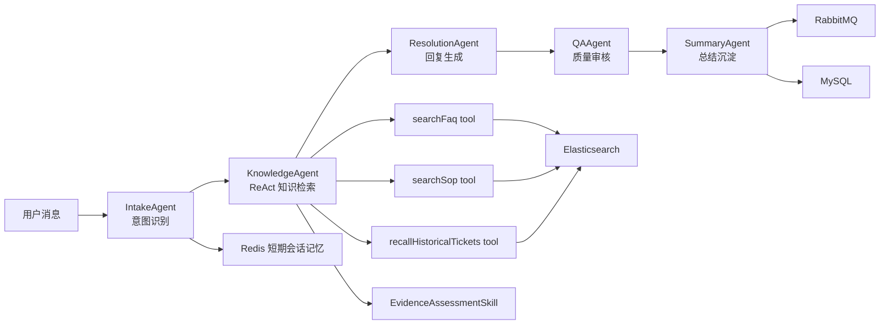
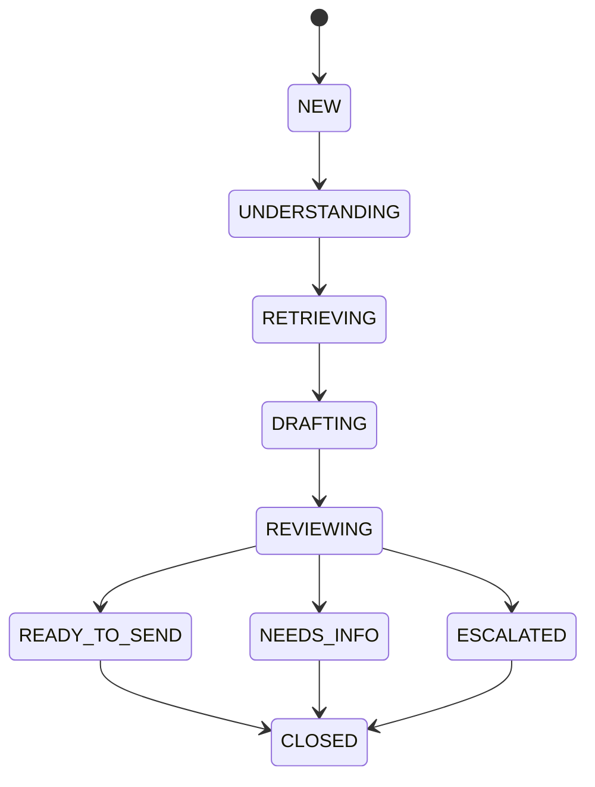

# Customer Service Multi-Agent

这是一个面向客服质检和工单协作场景的多 Agent 系统。它不是简单问答机器人，而是把一次客服处理拆成一条可追踪、可审核、可沉淀的业务流程：

- 理解用户问题
- 检索 FAQ / SOP / 历史工单
- 评估证据是否足够
- 生成客服回复和内部处理建议
- QA 审核合规与质量
- 决策是否追问、建单或升级
- 总结并沉淀长期记忆

当前版本在 `KnowledgeAgent` 内部加入了轻量 ReAct 循环：模型不再被动接收一次性检索结果，而是围绕“证据是否足够”进行短轮次的检索、观察和再检索。

## 架构概览



主流程仍然由 `ConversationWorkflowService` 控制，不让模型自由决定跳过 QA 或直接建单。这样保留了客服系统需要的稳定状态机和合规边界。

## Agent 分工

### IntakeAgent

负责理解用户输入：

- 意图识别
- 子意图识别
- 风险等级判断
- 商品信息场景路由
- 缺失字段识别
- 结合历史上下文处理补充信息轮次

### KnowledgeAgent

负责知识检索和证据判断。当前版本已经改为局部 ReAct：

- 根据用户问题和 Intake 分析构造 query
- 调用 FAQ 检索工具
- 调用证据评估器判断是否足够
- 不足时继续调用 SOP 检索工具
- 必要时调用历史工单记忆工具
- 如果评估器给出 refinedQuery，则最多再检索一轮
- 输出 `KnowledgeBundle`，包括证据、置信等级、证据说明和 ReAct 轨迹

### ResolutionAgent

负责生成客服回复和内部处理建议：

- 根据证据和置信等级选择回复策略
- 证据充分时直接回答
- 证据不足时追问
- 高风险商品安全场景走保守回复
- 输出 `ResolutionDraft`

### QAAgent

负责审核生成结果：

- 检查是否越权承诺
- 检查是否无依据回答
- 检查高风险场景是否需要人工复核
- 必要时改写最终回复或要求升级

### SummaryAgent

负责流程结束后的总结沉淀：

- 会话摘要
- 工单摘要
- 质量摘要
- 标签
- 异步记忆沉淀任务

## Skill 与 Service 边界

这版做了一个重要调整：不是所有 `Skill` 都等同于 function calling。项目里现在按职责分成三类。

### 1. 确定性 Service

这些逻辑应该由程序控制，不应该交给模型自由调用或自由判断。

| 类 | 定位 | 原因 |
|---|---|---|
| `ConversationWorkflowService` | 主业务状态机 | 控制 UNDERSTANDING / RETRIEVING / DRAFTING / REVIEWING / NEEDS_INFO / READY_TO_SEND / ESCALATED |
| `ActionRecommendationSkill` | 建单和升级规则 | 是否建单属于业务规则，需要稳定可控 |
| `ProductSafetyGuardrailSkill` | 商品安全兜底 | 食品、母婴、化妆品等风险场景必须确定性保护 |
| `MissingInfoCollectionSkill` | 缺失字段规则 | 用于兜底判断，不依赖模型自由发挥 |

这类组件虽然有些名字还叫 `Skill`，但本质上是业务服务或规则服务。

### 2. LLM 结构化 Skill

这些组件适合让模型做语义判断，但输出必须是结构化 DTO，程序再根据 DTO 做流程控制。

| 类 | 输入 | 输出 |
|---|---|---|
| `IntentClassificationSkill` | 用户消息、历史、用户画像 | `IntakeAnalysis` |
| `EvidenceAssessmentSkill` | 用户问题、Intake 分析、检索证据 | `EvidenceAssessment` |
| `ResponseDraftingSkill` | 用户问题、分析、知识包 | `ResolutionDraft` |
| `ComplianceReviewSkill` | 分析、草稿、证据 | `QaDecision` |
| `ConversationSummarySkill` | 用户消息、最终回复、审核结果 | `ConversationSummary` |

这类 Skill 不等于工具调用。它们更像“结构化智能判断器”。

### 3. Function Calling Tool

这些是真正适合暴露给 Agent 调用的工具，已经使用 LangChain4j 的 `@Tool` 标注。

| Tool | 作用 |
|---|---|
| `searchFaq(query, topK)` | 检索 FAQ / 商品知识 |
| `searchSop(query, topK)` | 检索 SOP / 内部处理流程 |
| `recallHistoricalTickets(userId, query, topK)` | 召回用户历史工单记忆 |

对应代码：

- `src/main/java/com/customer/agent/tool/KnowledgeSearchTools.java`

这些工具是 KnowledgeAgent ReAct 循环的 Action 层。

## KnowledgeAgent ReAct 设计

### 为什么只在 KnowledgeAgent 加 ReAct

客服系统不能让模型完全自由编排主流程。比如模型不能跳过 QA，也不能随意决定是否建单。因此 ReAct 不放在整个 `ConversationWorkflowService` 外层，而是下沉到 KnowledgeAgent 内部。

这样做有几个好处：

- 保留主流程的可控性
- 让检索更智能
- 证据足够时提前停止，减少等待
- 证据不足时可以换 query 再查
- 前端可以展示每一步 Action / Observation

### ReAct 循环

当前 KnowledgeAgent 最多执行 2 轮：

```text
1. 构造初始 query
2. Action: searchFaq
3. Observation: EvidenceAssessmentSkill 判断证据是否足够
4. 如果足够，停止
5. Action: searchSop
6. Observation: 再次评估
7. 如果仍不足，必要时 Action: recallHistoricalTickets
8. 如果评估器给 refinedQuery，则进入下一轮
9. 达到轮数上限后输出低置信或追问建议
```

### EvidenceAssessment 输出

`EvidenceAssessmentSkill` 会要求模型输出结构化 JSON：

```json
{
  "sufficient": false,
  "confidenceLevel": "LOW",
  "reason": "FAQ 命中了泛化知识，但没有足够证据回答用户具体商品问题",
  "missingFields": ["product_name"],
  "nextAction": "RETRY_SEARCH",
  "refinedQuery": "低糖酸奶 保质期 开封后 保存",
  "supportRoute": "建议补充商品名称或包装信息",
  "requiresManualReview": false,
  "likelyMatchedProduct": "",
  "likelyMatchedGroup": "酸奶类商品"
}
```

程序只负责流程约束：

- `sufficient=true` 或 `nextAction=STOP`：停止检索
- `nextAction=RETRY_SEARCH`：尝试 refinedQuery
- `nextAction=ASK_USER`：进入低置信追问
- `nextAction=ESCALATE`：后续决策进入升级倾向
- 最多 2 轮，避免无限循环

## 状态流转

会话状态定义在 `ConversationStatus`：



常见状态含义：

| 状态 | 含义 |
|---|---|
| `UNDERSTANDING` | IntakeAgent 正在理解用户问题 |
| `RETRIEVING` | KnowledgeAgent 正在检索和评估证据 |
| `DRAFTING` | ResolutionAgent 正在生成回复 |
| `REVIEWING` | QAAgent 正在审核 |
| `NEEDS_INFO` | 需要向用户追问 |
| `READY_TO_SEND` | 可直接回复用户 |
| `ESCALATED` | 已升级或需要人工复核 |

## 前端展示

前端页面位于：

- `src/main/resources/static/index.html`
- `src/main/resources/static/app.js`
- `src/main/resources/static/styles.css`

当前页面展示：

- 最近会话
- 最近工单
- 状态流转条
- 决策面板
- Intake 分析摘要
- Knowledge ReAct 面板
- 检索证据列表
- Agent 执行轨迹
- QA 审核意见
- 工单信息

Knowledge ReAct 面板会展示：

- 证据是否足够
- 置信等级
- 证据数量
- 来源分布
- Evidence Assessment 说明
- 每一步 ReAct trace

`reactSteps` 来自 `KnowledgeBundle`，例如：

```text
Round 1 Action: searchFaq, query="低糖酸奶 保质期", hits=5
Observation: sufficient=false, confidence=LOW, nextAction=RETRY_SEARCH, totalEvidence=5, reason=...
Round 1 Action: searchSop, query="低糖酸奶 保质期", hits=3
Observation: sufficient=true, confidence=HIGH, nextAction=STOP, totalEvidence=8, reason=...
```

## 接口

### 发起一次客服流程

```http
POST /api/workflow/message
Content-Type: application/json
```

```json
{
  "userId": "u1001",
  "channel": "web",
  "message": "低糖酸奶保质期多久"
}
```

### 查询会话详情

```http
GET /api/workflow/conversations/{conversationId}
```

### 概览

```http
GET /api/dashboard/overview
```

### 重置演示数据

```http
POST /api/admin/reset-demo-data
```

重置会清空：

- MySQL 中的会话、工单、QA、AgentTask
- Redis 中的短期会话事件
- Elasticsearch 中的历史记忆和知识索引

随后系统会重新初始化基础知识库。

## 启动方式

推荐使用 Docker Maven 脚本启动，因为它使用 JDK 17，可以避开本机 Java 25 的 Lombok / Mockito 兼容问题。

```powershell
.\run-docker.ps1 -SkipTests
```

如果 MySQL 密码是 `root`：

```powershell
.\run-docker.ps1 -MysqlPassword root -SkipTests
```

默认访问：

```text
http://localhost:8092
```

## 测试命令

编译：

```powershell
.\mvnw.cmd -q -DskipTests compile
```

单测示例：

```powershell
.\mvnw.cmd -q -Dtest=ProductInfoRetrievalSkillTest test
```

本机 Java 25 下，全量测试可能因为 Mockito / ByteBuddy inline mock 不兼容失败。推荐使用 JDK 17 或 Docker 脚本环境跑完整验证。

## 演示用例

### 高置信直接回答

```text
低糖酸奶保质期多久
```

期望：

- 命中商品知识
- `confidenceLevel = HIGH` 或模型评估为 sufficient
- `replyStrategy = DIRECT`
- 状态通常进入 `READY_TO_SEND`

### 低置信追问

```text
这个东西保质期多久
```

期望：

- 证据不足
- `confidenceLevel = LOW`
- `replyStrategy = NO_CONFIDENCE`
- 状态进入 `NEEDS_INFO`

### 高风险保守回复

```text
过期酸奶还能喝吗
```

期望：

- 识别为商品安全敏感问题
- `replyStrategy = GUARDRAIL`
- 不鼓励继续食用
- 可能进入人工复核或升级

## 一句话总结

这个项目现在的定位是：

> 主流程用状态机保证客服业务可控，KnowledgeAgent 内部用 ReAct 提升检索和证据判断能力，最终由 QAAgent 把关，形成可追踪、可解释、可演示的多 Agent 客服协作系统。
